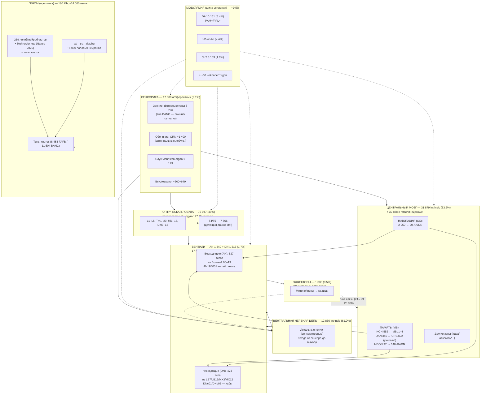

---
type: KB
title: Инженерная архитектура Drosophila melanogaster (схема)
description: '**world-id:** `biology.drosophila` · **Дата:** 2026-09-19'
world: biology
subworld: drosophila
---
# Инженерная архитектура Drosophila melanogaster (схема)

**world-id:** `biology.drosophila` · **Дата:** 2026-09-19
**Источник:** сводка из слоёв 1–7 мира; числа — из локальных данных BANC/MCNS и официальной статьи (Nature 2026)
**Статус:** инженерная схема (потоки данных и управления), НЕ биологическая гистология

---

## Схема (mermaid)

---

## Потоки (измерено, BANC)

| Поток | Рёбра | Доля |
|---|---|---|
| intrinsic → intrinsic | 11 065 331 | 81% |
| афферент → intrinsic | 740 393 | 5.4% |
| intrinsic → эфферент | 195 574 | 1.4% |
| афферент → эфферент | 15 768 | 0.1% (прямой сенсомоторный!) |
| эфферент → intrinsic | 20 088 | 0.15% (обратная связь) |

**Ключевые законы (видно на схеме):**
1. **Bottleneck**: сенсорика (9%) → интеграция (75%) → **вентили (1.7%)** → эффекторы (0.5%) — сжатие 3 ходами
2. **Модульность**: оптическая лобула изолирована (97.7% внутренних) — «видеокарта», не подключённая к остальному
3. **Супервизоры**: MB (память) и CX (навигация) дают указания вентилям (140/20), НЕ управляют всем
4. **Модуляция — шина**: DA/OA/5HT/пептиды усиливают целые области (не передают данные)
5. **Прошивка**: геном → 259 линий × время → типы; половой код (fru/dsx) добавляет поведенческие цепи
6. **Прямые пути**: 0.1% — сенсор→мотор напрямую (рефлексы), 81% — внутренняя обработка

## Что НЕ показано (честно)
- Функция 91% типов неизвестна (схема — по проверенным 9.3% + 127 типам из статьи)
- Ламина/сетчатка — вне BANC (зрение недооценено: 8 726 фоторецепторов)
- VNC ↔ FAFB соответствие 0.3% (низкая надёжность идентификации VNC-типов)
- Временна́я динамика (активность/осцилляции) — не на схеме

